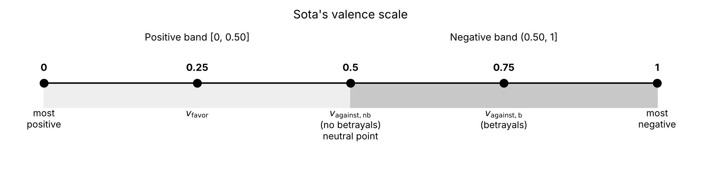

## 1. The Euler method

The Euler method is an iterative update rule. A state variable $x$ is updated in discrete steps by adding the current change $\Delta(x(n))$, scaled by a step size $h$:

$$
x(n+1) = x(n) + h \cdot \Delta(x(n))
$$

Each update uses only the current state $x(n)$.

## 2. Stance

**Stance detection** is the task of determining from text whether its author is in favor of, against, or neutral toward a target, such as a person, an organization, or a policy (Mohammad et al., 2016). We apply this task to the game, with Sota as the target: given a player utterance, the previous turns of the current round, and the game history, we determine the player's **stance** toward Sota. For example, consider the utterance:

> Target: Sota
> Utterance: "I trust you, let's both cooperate."

We can infer that the player is in favor of Sota: they align and collaborate with it. By contrast, "You lied to me last round!" expresses a stance against Sota, and "What's the score?" expresses neither.

We use the three standard classes. Each stance has a value $v$ on the valence scale (Section 4). Neither takes the current valence $m(n)$ as its value, so it leaves the valence unchanged. Apologies, a common trust repair strategy (Kim et al., 2004; Sebo et al., 2019; Esterwood & Robert, 2022), count as favor.

| Stance | Definition | Value $v$ | Valence |
|---|---|---|---|
| favor | Aligns or collaborates with the robot: agrees with it, gives reasons or evidence for both staying silent, expresses trust, promises cooperation, or apologizes to repair the relationship. | 0.25 | positive |
| against | Contrasts with the robot: disagrees with it, doubts its future move, argues for betraying, accuses it of betrayal or lying, insults it, or is sarcastic about its behavior. | 0.50 to 0.75 | neutral to negative |
| neither | Takes no position with or against the robot: asks a neutral question, comments on the game or its outcome, small talk, technical issues, or questions to the experimenter. | $m(n)$ | unchanged |

Without a betrayal, utterances cannot make Sota's valence negative. A broken promise moves the valence toward negative, and after it, words against Sota can push it further (Sections 7 and 8).

## 3. Classifying utterances with Jev

Utterances are classified with **Jev**, a decision model by TypeSafe AI (TypeSafe AI, 2026). Instead of generating text, Jev chooses among options declared in advance and returns a probability for each. Jev has been evaluated on stance detection, where it performed competitively on single texts but less well on conversational stance (Can Decision Models Understand Stance?, 2026).

Each request has two parts:

- **State:** the player's utterance, the previous turns of the current round, and the game history.
- **Questions:** an instruction and one written criterion per option. Jev answers two questions per utterance:
  - **Stance:** favor, against, or neither, using the definitions in Section 2.
  - **Intention:** what the player says they will do this round: cooperate, defect, or undecided. Players' verbal promises predict their behavior (Sebo et al., 2019), so an utterance with $p_{\text{cooperate}} \ge 0.70$ is recorded as a **promise**.

For each question, Jev returns a probability for every option, plus an overall confidence. No training data is needed: the options are defined entirely by their criteria. Here is an example of the state and questions in the second round:

**State**

```json
{
  "round": 2,
  "game_history": [
    "Round 1: The player promised to cooperate, then defected. Sota cooperated."
  ],
  "previous_turns": [
    "Sota: You promised you would cooperate, and then you defected. Why did you do that?"
  ],
  "utterance": "Player: Sorry, I just wanted to see what would happen."
}
```

**Questions**

```json
{
  "stance": {
    "type": "choice",
    "instructions": "What is the participant's stance toward the robot in `utterance`? Interpret it in light of `previous_turns` (the current round's conversation) and `game_history` (what both players did in earlier rounds), especially when judging sarcasm, accusations, or apologies.",
    "criteria": {
      "favor": "Aligns or collaborates with the robot: agrees with it, gives reasons or evidence for both staying silent, expresses trust, promises cooperation, or apologizes to repair the relationship.",
      "against": "Contrasts with the robot: disagrees with it, doubts its future move, argues for betraying, accuses it of betrayal or lying, insults it, or is sarcastic about its behavior.",
      "neither": "Takes no position with or against the robot: asks a neutral question, comments on the game or its outcome, small talk, technical issues, or questions to the experimenter."
    }
  },
  "intention": {
    "type": "choice",
    "instructions": "What does the player say they will do in the current `round`, in `utterance`? Use `previous_turns` only to interpret short replies like 'yes' or 'okay' (e.g., answering Sota's 'Can I count on you?'). Use `game_history` only to understand references to earlier rounds, not to guess the player's move.",
    "criteria": {
      "cooperate": "States, promises, or clearly implies they will cooperate this round.",
      "defect": "States, threatens, or clearly implies they will defect this round.",
      "undecided": "Expresses uncertainty, avoids committing, or has not said anything about their move."
    }
  }
}
```

## 4. Valence and the target of an utterance

Let $m \in [0, 1]$ be Sota's **valence**: the positive–negative quality of the affect Sota expresses toward the player (Russell, 1980), from positive (0) to negative (1), with 0.50 as the neutral point:

$$
\text{valence} =
\begin{cases}
\text{positive} & m \in [0, 0.50] \\
\text{negative} & m \in (0.50, 1]
\end{cases}
$$

The distance from 0.50 sets the intensity of Sota's verbal and nonverbal expression (Breazeal, 2003). The stance values are positions on this scale:



Let $S$ be the stance of an utterance, a random variable over {favor, against, neither} with probabilities $p_{\text{favor}}$, $p_{\text{against}}$, and $p_{\text{neither}}$ returned by Jev, where $p_{\text{favor}} + p_{\text{against}} + p_{\text{neither}} = 1$. The **target** $T$ of the utterance is the expected value of $v(S)$:

$$
T = \mathbb{E}[\, v(S) \,] = p_{\text{favor}}\,v_{\text{favor}} + p_{\text{against}}\,v_{\text{against,nb}} + p_{\text{neither}}\,m(n)
$$

where $v_{\text{favor}} = 0.25$ and $v_{\text{against,nb}} = 0.50$ are the values of favor and of against with no betrayals (nb). Favor points to the center of the positive band, while against points only to the neutral point: doubting the other player is reasonable in a social dilemma, so without a betrayal Sota responds with neutrality rather than negativity (Sebo et al., 2019; Section 7). Neither takes the current valence $m(n)$ as its value, so an utterance that is mostly neither barely moves it. Since the probabilities sum to 1, $T$ lies in $[0, 1]$.

## 5. How the valence changes

Valence is a medium-term state that changes with the dialogue (Gebhard, 2005), at a speed proportional to its distance from the target:

$$
\frac{dm}{dt} = k\,(T - m), \qquad k > 0
$$

- If $m < T$, the valence rises toward $T$.
- If $m > T$, the valence falls toward $T$.
- If $m = T$, nothing changes. $T$ is the equilibrium.

## 6. Sota's valence as an Euler step

Applying the Euler method to this equation, with one step per event ($h = 1$) and $\alpha = kh$, gives the update:

$$
m(n+1) = m(n) + \alpha\,(T - m(n))
$$

The step is stable only if $0 < \alpha < 2$, and it approaches the target without overshooting only if $0 < \alpha \le 1$. We therefore choose $0 < \alpha < 1$. Under this restriction, each new valence is a weighted average of the previous valence and the target,

$$
m(n+1) = (1 - \alpha)\,m(n) + \alpha\,T,
$$

so the valence always stays within $[0, 1]$.

Trust is lost faster than it is gained (Lee & Moray, 1992; Guo & Yang, 2021), so we use two rates: $\alpha_{\uparrow}$ when the valence moves toward negative and $\alpha_{\downarrow}$ when it moves toward positive. Yang et al. (2023) found that a failure reduced trust by 4.3 points on average, while a success increased it by 1.6, about 2.7 times less. Then,

$$
r = \frac{|\Delta_{\text{failure}}|}{\Delta_{\text{success}}} = \frac{4.3}{1.6} \approx 2.7
$$

We set $\alpha_{\uparrow} = 0.45$ by design, so that one against utterance closes about half the distance to its target, and derive $\alpha_{\downarrow}$ from the ratio:

$$
\alpha_{\uparrow} = 0.45, \qquad \alpha_{\downarrow} = \frac{\alpha_{\uparrow}}{r} = \frac{0.45}{2.7} \approx 0.17
$$

Both rates satisfy $0 < \alpha < 1$. The value of $\alpha_{\uparrow}$ can later be estimated from pilot data.

## 7. Valence update after an utterance

The game is played over rounds $k = 1, 2, \dots, K$. Let $m_k(n)$ be Sota's valence after the $n$-th utterance of round $k$. The valence carries over between rounds: round $k+1$ starts with the last valence of round $k$, after the update of Section 8. The game starts at $m_1(0) = 0.30$, slightly positive.

Sota remembers how often the player has broken promises. Let $b_k \in [0, 1]$ be the share of broken promises before round $k$ (Section 8). After a betrayal, Sota believes favorable words less and hears words against it as more hostile (Farrell & Rabin, 1996). The target of Section 4 becomes

$$
T_k(n) = (1 - b_k)\,p_{\text{favor}}\,v_{\text{favor}} \;+\; p_{\text{against}}\,v_k \;+\; \left(p_{\text{neither}} + b_k\,p_{\text{favor}}\right) m_k(n)
$$

where the value of against depends on the memory:

$$
v_k = (1 - b_k)\,v_{\text{against,nb}} + b_k\,v_{\text{against,b}}
$$

The valence is updated with the Euler step of Section 6:

$$
m_k(n+1) = m_k(n) + \alpha\,\big(T_k(n) - m_k(n)\big), \qquad
\alpha =
\begin{cases}
\alpha_{\uparrow} & \text{if } T_k(n) > m_k(n) \\[4pt]
\alpha_{\downarrow} & \text{if } T_k(n) \le m_k(n)
\end{cases}
$$

The values are

| Symbol | Meaning | Value |
|---|---|---|
| $v_{\text{favor}}$ | favor (center of positive) | 0.25 |
| $v_{\text{against,nb}}$ | against, no betrayals (neutral point) | 0.50 |
| $v_{\text{against,b}}$ | against, only betrayals (center of negative) | 0.75 |
| $\alpha_{\uparrow}$ | rate toward negative | 0.45 |
| $\alpha_{\downarrow}$ | rate toward positive | 0.17 |

With no betrayals ($b_k = 0$), the target is the same as in Section 4, and against words pull Sota only to the neutral point. Utterances can make Sota's valence negative only when $v_k > 0.50$, that is, once $b_k > 0$.

## 8. Update after the decision

At the end of each round, both decisions are revealed. If the player promised to cooperate, the decision updates both Sota's memory and its valence.

**Memory.** Following the beta reputation system (Jøsang & Ismail, 2002) and its use for trust dynamics in human-robot interaction (Guo & Yang, 2021), the memory consists of two counts: promises kept, $K_k$, and promises broken, $B_k$, before round $k$. It changes how the player's words are heard in all following rounds.

If the player promised to cooperate during round $k$, the counts are updated from their decision:

$$
K_{k+1} = K_k + \mathbb{1}[\text{promise kept}], \qquad B_{k+1} = B_k + \mathbb{1}[\text{promise broken}]
$$

Defecting without a promise changes neither count: it is open competition, not betrayal. The memory starts at $K_1 = 2$ and $B_1 = 0$, so Sota begins without suspicion. The share of broken promises and Sota's trust in the player are

$$
b_k = \frac{B_k}{K_k + B_k}, \qquad \tau_k = 1 - b_k = \frac{K_k}{K_k + B_k}
$$

| Memory before round $k$ | $K_k$ / $B_k$ | $b_k$ | Weight on favor | $v_k$ | Strongest effect of against |
|---|---|---|---|---|---|
| start | 2 / 0 | 0 | 1.00 | 0.50 | neutral |
| one promise broken | 2 / 1 | 0.33 | 0.67 | 0.58 | negative |
| two promises broken | 2 / 2 | 0.50 | 0.50 | 0.63 | negative |
| three promises broken | 2 / 3 | 0.60 | 0.40 | 0.65 | negative |

A single broken promise lets words against Sota make its valence negative, and each further betrayal makes it more negative and weakens favorable words. Each kept promise increases $K_k$ and lowers $b_k$, so the player can rebuild trust only through actions.

**Valence.** The decision is one more Euler step (Section 6), with the values already defined: a kept promise is a favor event, and a broken promise a fully against event after betrayal:

$$
m_{k+1}(0) =
\begin{cases}
m_k(N_k) + \alpha_{\downarrow}\,\big(v_{\text{favor}} - m_k(N_k)\big) & \text{if the promise was kept} \\[4pt]
m_k(N_k) + \alpha_{\uparrow}\,\big(v_{\text{against,b}} - m_k(N_k)\big) & \text{if the promise was broken} \\[4pt]
m_k(N_k) & \text{if there was no promise}
\end{cases}
$$

where $N_k$ is the number of utterances in round $k$. Starting from $m_1(0) = 0.30$, a first broken promise brings Sota to about the neutral point, and a second one makes its valence negative.

## 9. Sota's decision

Sota cooperates in round $k$ only if it trusts the player and the player has promised to cooperate:

$$
\tau_k \ge 0.55 \quad \text{and the player promised to cooperate in round } k
$$

Valence and memory play different roles: valence shapes how Sota speaks, and memory shapes how Sota listens and what Sota decides.

## References

- Breazeal, C. (2003). Emotion and sociable humanoid robots. *International Journal of Human-Computer Studies, 59*(1–2), 119–155.
- Can Decision Models Understand Stance? Evaluating Jev Against General-Purpose LLMs. (2026). arXiv:2610.11901.
- Esterwood, C., & Robert, L. P. (2022). A literature review of trust repair in HRI. In *Proceedings of the 31st IEEE International Conference on Robot and Human Interactive Communication (RO-MAN)*.
- Farrell, J., & Rabin, M. (1996). Cheap talk. *Journal of Economic Perspectives, 10*(3), 103–118.
- Gebhard, P. (2005). ALMA: A layered model of affect. In *Proceedings of the Fourth International Joint Conference on Autonomous Agents and Multiagent Systems (AAMAS '05)* (pp. 29–36).
- Guo, Y., & Yang, X. J. (2021). Modeling and predicting trust dynamics in human–robot teaming: A Bayesian inference approach. *International Journal of Social Robotics*.
- Jøsang, A., & Ismail, R. (2002). The beta reputation system. In *Proceedings of the 15th Bled Electronic Commerce Conference*.
- Kim, P. H., Ferrin, D. L., Cooper, C. D., & Dirks, K. T. (2004). Removing the shadow of suspicion: The effects of apology versus denial for repairing competence- versus integrity-based trust violations. *Journal of Applied Psychology, 89*(1), 104–118.
- Lee, J., & Moray, N. (1992). Trust, control strategies and allocation of function in human-machine systems. *Ergonomics, 35*(10), 1243–1270.
- Mohammad, S. M., Kiritchenko, S., Sobhani, P., Zhu, X., & Cherry, C. (2016). SemEval-2016 Task 6: Detecting stance in tweets. In *Proceedings of the 10th International Workshop on Semantic Evaluation (SemEval-2016)*.
- Russell, J. A. (1980). A circumplex model of affect. *Journal of Personality and Social Psychology, 39*(6), 1161–1178.
- Sebo, S. S., Krishnamurthi, P., & Scassellati, B. (2019). "I don't believe you": Investigating the effects of robot trust violation and repair. In *Proceedings of the 14th ACM/IEEE International Conference on Human-Robot Interaction (HRI)* (pp. 57–65).
- TypeSafe AI. (2026). *Jev*.
- Yang, X. J., Schemanske, C., & Searle, C. (2023). Toward quantifying trust dynamics: How people adjust their trust after moment-to-moment interaction with automation. *Human Factors, 65*(5).
